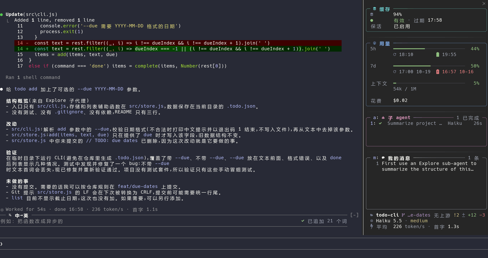
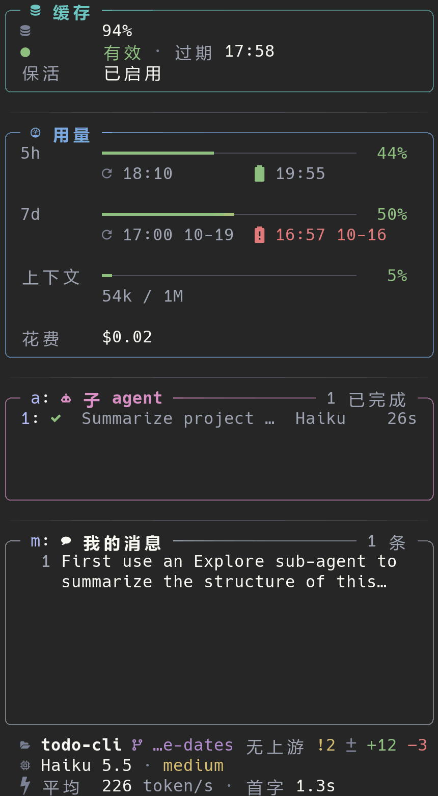
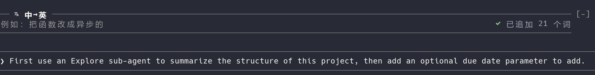

# anvil

[](LICENSE)
[](https://docs.claude.com/en/docs/claude-code)
[](#requirements)
[](#language)

English | [简体中文](README.zh-CN.md)

**A Claude Code mod that keeps long sessions cheap and readable.** It keeps your prompt cache warm while you're away, stops the one message that would rebuild a cold cache, docks a panel beside the transcript with everything a status line used to show and more, and gives you a box to write in Chinese and send in English.

<p align="center">
  
</p>

<p align="center">
  <a href="#install">Install</a> · <a href="#features">Features</a> · <a href="#getting-started">Getting started</a> · <a href="#configure">Configure</a> · <a href="#faq">FAQ</a> · <a href="#development">Development</a>
</p>

## Features

- **Cache keepalive.** When a session with a large context sits idle, anvil sends one background request shortly before the prompt cache expires. The request reads the cache, stays out of the transcript, and keeps your next message from paying for a full rebuild. It runs for up to 12 hours per idle stretch.
- **Cold-send guard.** If the cache has already expired and the context is large, anvil holds back your next message once and tells you what sending it will cost (tokens and an API-price estimate). Press Enter again to send it, or `/clear` to start fresh.
- **A docked panel.** From top to bottom: cache (hit rate, expiry, keepalive), usage (5-hour and 7-day limits with reset times and a forecast, context, session cost), subagents, auto-mode denials, your messages (press Enter on one to scroll the transcript to it), and three identity rows (directory and git status, model and effort, average output speed and time to first token). Each reply's own speed is added to the end of Claude Code's "Worked for …" line.
- **Chinese-to-English box.** A second input above the prompt: write in Chinese, press Enter, and the English translation is appended to the main prompt for you to check and send. It uses Haiku or Sonnet from your subscription, or any OpenAI-compatible API you configure.

| Panel | Translation box |
| --- | --- |
|  | <br><br>The translation lands in the main prompt; nothing is sent until you press Enter there. |

## Requirements

- **Claude Code 2.1.296 or later** (tested on 2.1.299). Mods are an early-access Claude Code feature and their API can change between releases.
- **Fullscreen rendering**: run `/tui fullscreen`, or set `CLAUDE_CODE_NO_FLICKER=1`. The panel docks only in fullscreen.
- **A terminal at least 110 columns wide.** The panel opens by itself at session start from 144 columns; between 110 and 144 it opens on your first message. Below 110 columns Claude Code places it inline above the prompt.
- **A [Nerd Font](https://www.nerdfonts.com/)** in your terminal, for the icons.
- **A Claude subscription** (Pro or Max) is what the keepalive is designed for: anvil assumes the main session's 1-hour cache TTL, which only holds on a subscription.

### Language

The interface is in Chinese for now. Support for other languages is planned.

## Install

Inside Claude Code:

```
/plugin install anvil --marketplace Mistakey/anvil
/reload-plugins
```

<details>
<summary><strong>Step by step, from the terminal, or from a clone</strong></summary>

Add the marketplace, then install from it:

```
/plugin marketplace add Mistakey/anvil
/plugin install anvil@anvil
```

From the terminal:

```sh
claude plugin marketplace add Mistakey/anvil
claude plugin install anvil@anvil
```

Or load it straight from a clone, for one session:

```sh
git clone https://github.com/Mistakey/anvil
claude --plugin-dir ./anvil
```

</details>

The installer may say config options aren't set; the defaults are fine, and [`/config`](#configure) changes them.

## Getting started

### 1. Open a session

Start Claude Code in fullscreen in a wide terminal. The panel docks on the right and the translation box appears above the prompt. Drag the panel's left edge to resize it; Claude Code remembers the width.

### 2. Read the panel

| Section | Shows |
| --- | --- |
| **缓存** (cache) | this session's cache hit rate; whether the cache is valid and when it expires, or how long ago it expired; the keepalive state |
| **用量** (usage) | 5-hour and 7-day usage with reset times and the time you're forecast to run out; context used out of the window; session cost |
| **子 agent** (subagents) | appears once the session has a subagent: status, task, model, running time |
| **自动模式拒绝** (auto-mode denials) | appears once the auto-mode classifier denies something: time, tool, the command or path with secrets masked |
| **我的消息** (my messages) | what you sent this session, oldest at the top |
| identity rows | directory, branch, ahead/behind, conflicts, staged, modified, untracked, stashes, uncommitted lines, a paused merge or rebase; model and effort; average output speed (token/s) and time to first token |

### 3. Use the keys

Click the panel, or press `ctrl+x tab` (twice while the translation box is showing: focus cycles prompt → translation box → panel). Then:

| Key | Does |
| --- | --- |
| `1`–`9` | expand that subagent: its task, what it ran, its last calls, its answer |
| `a` / `d` / `m` | expand the subagents, auto-mode denials or my messages list |
| `↑` `↓` | move between list titles and items |
| `Enter` | press the focused item: expand a list, open a subagent or denial, or scroll the transcript to a message |
| `Esc` | collapse and return to the prompt |

### 4. Translate

Click the translation box or press `ctrl+x tab`, write in Chinese, and press Enter. The English lands at the end of the main prompt, on its own line. Check it, edit it, and send it from the main prompt. `Shift+Enter` adds a line break, and a Chinese input method works as usual. Code, paths and English terms in your text are kept as they are.

### 5. Commands

Each subcommand toggles something for the current session only. A new session starts from the defaults.

| Command | Does |
| --- | --- |
| `/anvil` | list the subcommands and their current state |
| `/anvil panel` | hide or show the panel |
| `/anvil translate` | hide or show the translation box |
| `/anvil keepalive` | turn the keepalive off or on for this session, regardless of the threshold |

Closing the panel by hand counts as hiding it: it stays closed for the session until you run `/anvil panel`.

### How the keepalive works

- anvil estimates the cache's expiry itself: the last main-session request plus 1 hour.
- When a session's context reaches the threshold (50k tokens by default) and it goes idle, anvil waits 50 minutes and sends one background request (`$.model.fork`) that asks for a one-word reply. It doesn't enter your transcript.
- Each request checks its own usage: if it read close to the whole context and wrote little, the cache counts as renewed and the next request is scheduled. Otherwise the keepalive stops and says why in the cache section: no cache read, too much written, an error, or 12 hours idle.
- Stopping only ends the current idle stretch. Once you send a message, the next idle stretch is kept warm again.
- Each request costs about one read of the whole context plus a few output tokens, counted against your plan. Claude Code has to stay open.

### How the guard works

- When the cache has expired and the context is at or above the threshold, anvil drops your next message once, puts it back in the prompt, and shows a line like: *anvil：缓存已过期 1h10m，发送这条消息要重建 152k tokens（约 $3.04）……* (cache expired 1h10m ago; sending this message rebuilds 152k tokens, about $3.04).
- Press Enter again to send it, or use `/clear` if you don't need the old context.
- Slash commands and messages sent by plugins pass straight through. Nothing is blocked right after a compaction or a `/clear`.

## Configure

Run `/config` and open anvil's options:

| Option | Default | Meaning |
| --- | --- | --- |
| `threshold` | `50000` | context size in tokens at which the keepalive turns on by itself and the guard starts guarding |
| `autoKeepalive` | `true` | turn the keepalive on by itself for sessions at or above the threshold; `/anvil keepalive` still toggles it per session |
| `guard` | `true` | hold back the first message after the cache has expired |
| `translateBackend` | `haiku` | `haiku` or `sonnet` from your subscription, or `api` for your own OpenAI-compatible API |
| `translateApiUrl` | | the API's base URL (`…/v1`) or full `…/chat/completions` URL, for `api` |
| `translateApiModel` | | the model name to request, for `api` |

The API key is read from the `ANVIL_TRANSLATE_API_KEY` environment variable, never from settings.

## What it touches

| It does | Through |
| --- | --- |
| reads session events: requests and their usage, subagents, tool calls, auto-mode denials, messages you send | the mod hooks |
| sends the keepalive request | `$.model.fork`, only while a session is idle |
| translates | `$.model.complete` with Haiku or Sonnet, or an HTTPS request to the API you configured |
| runs `git` in the session's directory, read-only (`--no-optional-locks`) | `$.process.run` |
| keeps recent usage readings for the forecast, shared by your local sessions | `$.store` |

Nothing else leaves your machine. `claude plugin validate .` prints every hook and call the mod makes.

## FAQ

**The panel doesn't appear.**
Check that rendering is fullscreen and the terminal is at least 110 columns wide; below 144 columns the panel opens on your first message rather than at start. If you hid or closed it, run `/anvil panel`. If it still doesn't show, look in the transcript for a line from Claude Code that names a failed anvil hook, and [open an issue](https://github.com/Mistakey/anvil/issues) with it.

**The icons show as boxes or question marks.**
Your terminal font isn't a Nerd Font. Install one and select it in the terminal's settings.

**Does the cache state match what Claude Code itself tracks?**
It's an estimate. A mod can't read Claude Code's own cache tracker, so anvil works from request times and usage. Requests anvil doesn't see (another plugin's fork, Claude Code's built-in keepalive) can make it conservative: at worst the guard warns once too often or the keepalive sends one extra request.

**Does it work on an API key, or with a 5-minute cache?**
The panel and the translation box do. The keepalive and the guard assume the 1-hour TTL of a subscription.

**Why are the dollar amounts API prices if I'm on a subscription?**
How cache reads and writes count against subscription limits isn't documented, so API prices are the only comparable measure. The session cost in the usage section is the figure Claude Code reports (`/cost`).

**My organization manages Claude Code.**
Under managed settings, Claude Code doesn't deliver three events (`classic.SessionStart`, `classic.PermissionDenied`, `session.compact`) to plugins a person installs. There, the auto-mode denials list stays empty, and the cache state doesn't pick up a resumed session or a compaction, unless your organization lists anvil in managed settings.

**`/clear` or `/resume` reset the panel.**
That's expected: a new conversation starts its counts from zero.

## Development

The repository is the plugin: `.claude-plugin/plugin.json` is the manifest and `hooks/register.ts` is the entry. Claude Code loads the TypeScript directly; there's no build step.

```sh
claude --plugin-dir .              # load it; saving a file hot-reloads
claude plugin validate .           # hooks, calls, and anything Claude Code would reject
claude plugin test .               # run tests/*.test.ts
npx -p typescript tsc -p .         # type-check
```

Type declarations for the current Claude Code build are generated into `.claude-plugin/types/` the first time the plugin loads in an interactive session. Without one, generate them with `CLAUDE_CODE_PLUGIN_DIR_WATCH=1 claude --plugin-dir . -p "ok" --model haiku --max-turns 1`.

[`CONTEXT.md`](CONTEXT.md) defines the terms, [`AGENTS.md`](AGENTS.md) collects the conventions and the known pitfalls of the mods API, and [`docs/adr/`](docs/adr) records the design decisions. These are in Chinese.

## Acknowledgements

- [Flightdeck](https://github.com/scasella/claude-flightdeck) by Stephen Casella: the docked pane, the subagent list, secret masking and the client-side animation pattern.
- [cache-tax](https://github.com/karanb192/cache-tax) by Karan Bansal: the cache estimate, the keepalive loop and the cold-send guard.

Both are MIT-licensed. [`THIRD_PARTY_NOTICES.md`](THIRD_PARTY_NOTICES.md) lists what anvil adapted from each and reproduces their licenses.

## License

[MIT](LICENSE)
